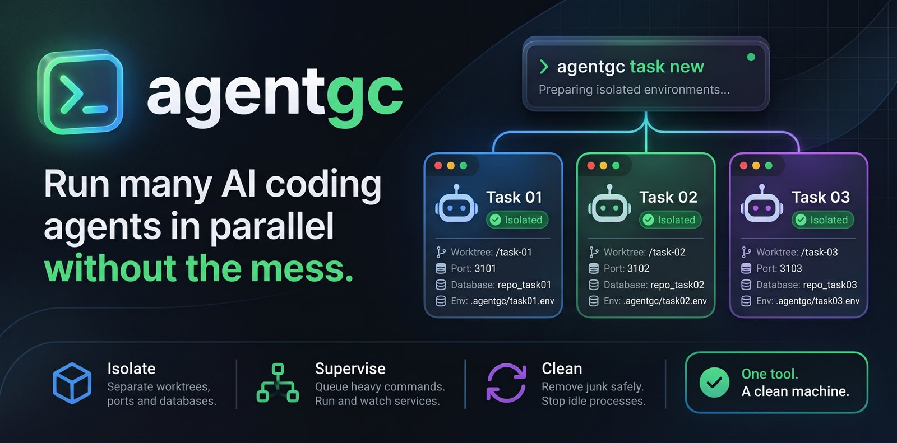

<p align="center">
  
</p>

<h1 align="center">agentgc</h1>

<p align="center">
  <b>Run many AI coding agents in parallel without the mess.</b><br>
  Isolated task environments, a process supervisor and a safe cleanup<br>
  for Claude Code, Codex and other CLI agents.
</p>

<p align="center">
  <a href="LICENSE"></a>
  
  <a href="https://github.com/JohnWayneeee/agentgc/releases/latest"></a>
  <a href="https://github.com/JohnWayneeee/agentgc/actions/workflows/ci.yml"></a>
  
  <a href="https://github.com/JohnWayneeee/agentgc/stargazers"></a>
  <a href="https://github.com/JohnWayneeee/agentgc/commits/main"></a>
  <a href="CONTRIBUTING.md"></a>
  <a href="https://t.me/+pWGhdQdw5DZmYzYy"></a>
</p>

<p align="center">
  <a href="#why-agentgc">Why</a> ·
  <a href="#features">Features</a> ·
  <a href="#quick-start">Quick start</a> ·
  <a href="#commands">Commands</a> ·
  <a href="#teach-your-agent">Teach your agent</a> ·
  <a href="#safety-by-design">Safety</a> ·
  <a href="#faq">FAQ</a> ·
  <a href="docs/reference.md">Reference</a> ·
  <a href="README.ru.md">Русский</a>
</p>

<br>

<h2 align="center" id="why-agentgc">Why agentgc</h2>

<p align="center">
  You run several coding agents at once, each in its own git worktree.<br>
  Git keeps the files apart. It does not keep ports, databases, processes or disk space apart.
</p>

<div align="center">

| Without agentgc | With agentgc |
|---|---|
| Two dev servers fight for the same port | Each task gets its own free ports |
| Every agent writes to one shared database | Each task gets its own database name |
| Five builds start at once and the machine freezes | Heavy commands take turns with `agentgc run` |
| Finished task folders and caches fill the disk | `clean` removes junk item by item, `task done` removes a task safely |
| Forgotten dev servers keep holding RAM | `ps --stop` stops the idle ones |

</div>

<p align="center"><i>agentgc does not start AI agents. It prepares the environment around them, runs the services of each task, and cleans up afterwards.</i></p>

<p align="center">Prefer to do it by hand? Read the <a href="https://dev.to/ghost_wayne/parallel-ai-coding-agents-in-git-worktrees-how-to-stop-the-collisions-4gb">step-by-step guide on dev.to</a>.</p>

<br>

<h2 align="center" id="features">Features</h2>

<div align="center">

| | |
|---|---|
| **Isolate** | One worktree, free ports, a database name and an env file per task. Optional compose file and `*.localhost` route per task. |
| **Supervise** | `up`, `down`, `status`, `logs` and `restart` run plain processes per task. Opt-in, no system service, no network port. |
| **Queue** | `run` lets heavy commands take turns and guards named exclusive resources, such as one phone or one browser profile. |
| **Clean** | `scan` and `clean` remove junk one item at a time. `task done` removes a finished task. `ps --stop` stops idle servers. |

</div>

<br>

<h2 align="center" id="quick-start">Quick start</h2>

<p align="center">
  Download a build for your system, or build it from source.
</p>

Download the archive for Windows, Linux or macOS (Apple Silicon) from the [latest release](https://github.com/JohnWayneeee/agentgc/releases/latest). Unpack it and put `agentgc` on your `PATH`. Check the `.sha256` file next to the archive.

Or build it from source. agentgc is a Rust project:

```sh
cargo install --path .
```

Or run `cargo build --release` and use `target/release/agentgc`.

Put the task settings in `agentgc.task.toml` in the repo root:

<details>
<summary>Example <code>agentgc.task.toml</code></summary>

```toml
[ports]
names = ["web", "api"]

[db]
create = "createdb {db}"

[services.web]
cmd = "npm run dev -- --port {{port.web}}"
port = "web"

[services.api]
cmd = "cargo run -- --port {{port.api}} --db {{db}}"
cwd = "apps/api"
port = "api"
```

</details>

Then, in the repo root:

```sh
agentgc task new feat-login --yes    # worktree, ports, env file, services
agentgc up --task feat-login         # start the services
agentgc status --task feat-login     # pid, state and URL per service
agentgc down --task feat-login       # stop the services
agentgc task done feat-login --yes   # remove the task (refuses unsaved work)
```

`task new` and `task done` print a plan first. `--yes` runs it.

<details>
<summary>What the output looks like (shortened)</summary>

```text
$ agentgc task new feat-login --yes
registered .agentgc/tasks/feat-login.json (state: creating)
created worktree worktrees/feat-login on branch feat-login
wrote worktrees/feat-login/.agentgc/task.env
route api: api.feat-login.localhost:3101
task feat-login is ready

$ agentgc up --task feat-login
supervisor started (pid 27980)
  SERVICE   PID    STATE    RUNNING  RESTARTS  PORT  URL
  api       8332   running  yes      0         3101  http://api.feat-login.localhost:3101
```

</details>

<br>

<h2 align="center" id="commands">Commands</h2>

<div align="center">

| Command | What it does |
|---|---|
| `agentgc scan` | Lists junk: package caches, downloaded browser builds, agent sessions, temp files. Read-only. |
| `agentgc worktrees` | Finds orphan worktrees and duplicate dependency folders. Read-only. |
| `agentgc clean` | Deletes listed junk one item at a time, with a confirmation for each item. |
| `agentgc ps` | Shows which processes belong to which task, with their RAM. Read-only. |
| `agentgc ps --stop` | Stops idle dev servers, language servers, tests and builds. Dry run by default. |
| `agentgc task new` / `list` / `done` | Creates, lists and removes a task environment: worktree, ports, env file, database name. |
| `agentgc up` / `down` / `status` / `logs` / `restart` | Starts, stops, restarts and checks a task's services, and shows their logs. |
| `agentgc run` | Queues heavy commands so only some run at once. Guards named exclusive resources. |
| `agentgc init` | Installs the agent rules into `AGENTS.md`, `CLAUDE.md` and a Claude Code skill, after you confirm each file. |

</div>

<p align="center">
  Config sections <code>[compose]</code>, <code>[routes]</code> and <code>[services]</code> add a compose file per task, route URLs and plain processes per task.<br>
  Every flag and rule: <a href="docs/reference.md">docs/reference.md</a>
</p>

<br>

<h2 align="center" id="teach-your-agent">Teach your agent</h2>

<p align="center">
  An agent only uses a tool it knows about. Give it the rules once.<br>
  Let <code>agentgc init</code> do it:
</p>

```sh
cd my-repo
agentgc init                          # dry run: shows what would happen per file, writes nothing
agentgc init --global-skill           # also the skill for all your projects
```

`init` prints a plan for `AGENTS.md`, `CLAUDE.md` and `.claude/skills/agentgc/SKILL.md`, then asks `Write this? [y/N/q]` for each file. It adds only a marked block to `AGENTS.md` and `CLAUDE.md` and keeps a `.agentgc.bak` copy. It never overwrites an existing `SKILL.md`. Without a terminal, name the files with `--yes-target`. `agentgc init --print` prints the snippet and writes nothing. Restart the agent afterwards so it reads the rules.

<details>
<summary>Or do it by hand</summary>

- **Any agent** (Codex, Claude Code, others): paste [integrations/AGENTS.md](integrations/AGENTS.md) into your `AGENTS.md` or `CLAUDE.md`.
- **Claude Code skill:** copy [integrations/claude-code/SKILL.md](integrations/claude-code/SKILL.md) to `.claude/skills/agentgc/SKILL.md` in your project, or to `~/.claude/skills/agentgc/SKILL.md` for all projects.

The rules tell the agent which commands are read-only, how to read its ports and database name from `.agentgc/task.env`, and which commands it must never run without asking you (`clean`, `ps --stop --yes`, `--force`).

</details>

<br>

<h2 align="center" id="safety-by-design">Safety by design</h2>

- Dry run is the default for `task new`, `task done` and `ps --stop`.
- `clean` asks before each item. Only `y` deletes a `safe` item. An `ask` item needs its id typed.
- `ask` items go to the Recycle Bin or Trash. They are never deleted for good.
- Browser profiles and user data are not in the built-in rules. A deny-list refuses paths with names such as `User Data`, `Profile` or `Documents`.
- A path that holds a `.git` entry is refused. It is a project, not a cache.
- Without a terminal, `clean` deletes only the items named with `--yes-item`.
- `ps --stop` and `task done` never stop agents, databases or other processes. `clean` never kills a process.
- agentgc opens no network port, installs no system service and does not start at boot or login.

> [!WARNING]
> Tests pass on Windows, Linux and macOS in GitHub Actions. The full flow was run by hand on Windows only. Report problems on Linux and macOS in an issue.
> The release binaries are not code signed. Windows SmartScreen or macOS Gatekeeper can warn on first start.
> On Windows, `ps --stop` needs `--force`, because agentgc has no graceful stop there.
> The supervisor is opt-in and per task. Services start only when you run `up`.

<br>

<h2 align="center" id="how-it-compares">How it compares</h2>

<div align="center">

| Instead of | agentgc adds |
|---|---|
| A shell script | A check of each path against guards, and a question per item. |
| Worktree helpers alone | Free ports, a task env file, and a `task done` that refuses while work is unsaved. |
| A queue tool alone | Named exclusive resources and Windows support. |

</div>

<p align="center">
  Idea credit: <a href="https://github.com/mokevnin/heavy">heavy</a> by mokevnin, a counting semaphore for macOS and Linux.<br>
  <code>agentgc run</code> is separate code.
</p>

<br>

<h2 align="center" id="faq">FAQ</h2>

<details>
<summary><b>Does it delete my files without asking?</b></summary>

No. `clean` asks before each item, and `ask` items go to the Recycle Bin. `task done` runs only with `--yes`, and it refuses when work is unsaved.

</details>

<details>
<summary><b>Does it run a daemon?</b></summary>

No. Nothing runs in the background unless you start it. `run` has no daemon. `up` starts one supervisor for one task, and `down` stops it.

</details>

<details>
<summary><b>Which agents does it work with?</b></summary>

The built-in rules cover Claude Code, Codex CLI and Gemini CLI. The process rules also match OpenCode. For other agents, write your own rules: `--rules` for `scan` and `clean`, `--proc-rules` for `ps`.

</details>

<details>
<summary><b>Does it need Docker?</b></summary>

No. agentgc never runs docker or starts containers. The compose file is optional, and `[services]` runs plain processes.

</details>

<details>
<summary><b>Is it safe to use on my system?</b></summary>

Tests pass on Windows, Linux and macOS, and the limits above apply. Run `clean --dry-run` first, and use `--force` for stops.

</details>

<br>

<h2 align="center" id="contributing">Contributing and security</h2>

<p align="center">
  Pull requests are welcome. Read <a href="CONTRIBUTING.md">CONTRIBUTING.md</a> first:<br>
  changes are judged by safety, and tests use temp folders only.<br>
  Report a safety bug through the Security tab, not a public issue. See <a href="SECURITY.md">SECURITY.md</a>.
</p>

<h2 align="center" id="support">Support</h2>

<p align="center">
  If agentgc saves you time, a star on GitHub helps others find it.<br>
  Updates and notes: <a href="https://t.me/+pWGhdQdw5DZmYzYy">Telegram channel</a>
</p>

<h2 align="center" id="license">License</h2>

<p align="center">
  Released under the <a href="LICENSE">MIT License</a>.
</p>
