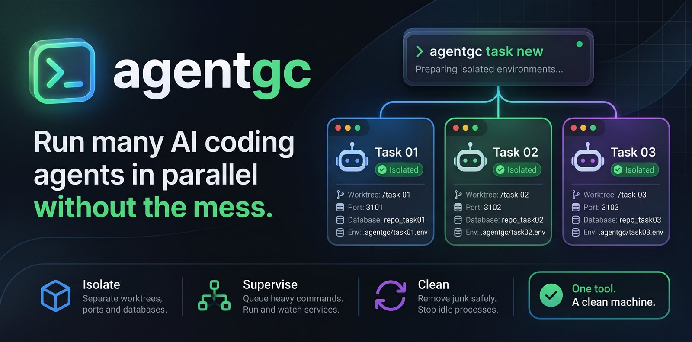

<p align="center">
  
</p>

<h1 align="center">agentgc</h1>

<p align="center">
  <b>Запускайте много ИИ-агентов для кода параллельно без хаоса.</b><br>
  Изолированные среды задач, супервизор процессов и безопасная очистка<br>
  для Claude Code, Codex и других CLI-агентов.
</p>

<p align="center">
  <a href="LICENSE"></a>
  
  
  <a href="https://github.com/JohnWayneeee/agentgc/stargazers"></a>
  <a href="https://github.com/JohnWayneeee/agentgc/commits/main"></a>
  <a href="CONTRIBUTING.md"></a>
  <a href="https://t.me/+pWGhdQdw5DZmYzYy"></a>
</p>

<p align="center">
  <a href="#why-agentgc">Зачем</a> ·
  <a href="#features">Возможности</a> ·
  <a href="#quick-start">Быстрый старт</a> ·
  <a href="#commands">Команды</a> ·
  <a href="#teach-your-agent">Научите агента</a> ·
  <a href="#safety-by-design">Безопасность</a> ·
  <a href="#faq">Вопросы</a> ·
  <a href="docs/reference.md">Справка</a> ·
  <a href="README.md">English</a>
</p>

<br>

<h2 align="center" id="why-agentgc">Зачем нужен agentgc</h2>

<p align="center">
  Вы запускаете несколько агентов для кода одновременно, каждого в своем git worktree.<br>
  Git разделяет файлы. Порты, базы данных, процессы и место на диске он не разделяет.
</p>

<div align="center">

| Без agentgc | С agentgc |
|---|---|
| Два dev-сервера борются за один порт | У каждой задачи свои свободные порты |
| Все агенты пишут в одну общую базу | У каждой задачи свое имя базы данных |
| Пять сборок стартуют разом, и машина зависает | Тяжелые команды идут по очереди через `agentgc run` |
| Папки готовых задач и кэши забивают диск | `clean` убирает мусор по одному элементу, `task done` безопасно убирает задачу |
| Забытые dev-серверы занимают память | `ps --stop` останавливает простаивающие |

</div>

<p align="center"><i>agentgc не запускает ИИ-агентов. Он готовит окружение вокруг них, запускает сервисы каждой задачи и убирает за ними.</i></p>

<p align="center">Хотите сделать вручную? Читайте <a href="https://dev.to/ghost_wayne/parallel-ai-coding-agents-in-git-worktrees-how-to-stop-the-collisions-4gb">пошаговое руководство на dev.to</a> (на английском).</p>

<br>

<h2 align="center" id="features">Возможности</h2>

<div align="center">

| | |
|---|---|
| **Изолировать** | Свой worktree, свободные порты, имя базы и файл env на каждую задачу. По желанию compose-файл и адрес `*.localhost` на задачу. |
| **Следить** | `up`, `down`, `status`, `logs` и `restart` ведут обычные процессы задачи. По выбору, без системного сервиса и без сетевого порта. |
| **Очередь** | `run` ставит тяжелые команды в очередь и защищает именованные эксклюзивные ресурсы, например один телефон или один профиль браузера. |
| **Чистить** | `scan` и `clean` убирают мусор по одному элементу. `task done` убирает готовую задачу. `ps --stop` останавливает простаивающие серверы. |

</div>

<br>

<h2 align="center" id="quick-start">Быстрый старт</h2>

<p align="center">
  Соберите из исходников. agentgc написан на Rust.
</p>

```sh
cargo install --path .
```

Или выполните `cargo build --release` и используйте `target/release/agentgc`.

Положите настройки задач в `agentgc.task.toml` в корне репозитория:

<details>
<summary>Пример <code>agentgc.task.toml</code></summary>

```toml
[ports]
names = ["web", "api"]

[db]
create = "createdb {db}"

[services.web]
cmd = "npm run dev -- --port {{port.web}}"
port = "web"

[services.api]
cmd = "cargo run -- --port {{port.api}} --db {{db}}"
cwd = "apps/api"
port = "api"
```

</details>

Затем в корне репозитория:

```sh
agentgc task new feat-login --yes    # worktree, порты, файл env, сервисы
agentgc up --task feat-login         # запустить сервисы
agentgc status --task feat-login     # pid, состояние и адрес каждого сервиса
agentgc down --task feat-login       # остановить сервисы
agentgc task done feat-login --yes   # удалить задачу (отказ при несохраненной работе)
```

Команды `task new` и `task done` сначала печатают план. `--yes` выполняет его.

<details>
<summary>Как выглядит вывод (сокращенно)</summary>

```text
$ agentgc task new feat-login --yes
registered .agentgc/tasks/feat-login.json (state: creating)
created worktree worktrees/feat-login on branch feat-login
wrote worktrees/feat-login/.agentgc/task.env
route api: api.feat-login.localhost:3101
task feat-login is ready

$ agentgc up --task feat-login
supervisor started (pid 27980)
  SERVICE   PID    STATE    RUNNING  RESTARTS  PORT  URL
  api       8332   running  yes      0         3101  http://api.feat-login.localhost:3101
```

</details>

<br>

<h2 align="center" id="commands">Команды</h2>

<div align="center">

| Команда | Что делает |
|---|---|
| `agentgc scan` | Показывает мусор: кэши пакетов, скачанные сборки браузеров, сессии агентов, временные файлы. Только чтение. |
| `agentgc worktrees` | Находит осиротевшие worktree и дублирующиеся папки зависимостей. Только чтение. |
| `agentgc clean` | Удаляет найденный мусор по одному элементу, с подтверждением для каждого. |
| `agentgc ps` | Показывает, какие процессы относятся к каким задачам, и их память. Только чтение. |
| `agentgc ps --stop` | Останавливает простаивающие dev-серверы, языковые серверы, тесты и сборки. По умолчанию только проверка. |
| `agentgc task new` / `list` / `done` | Создает, показывает и удаляет окружение задачи: worktree, порты, файл env, имя базы. |
| `agentgc up` / `down` / `status` / `logs` / `restart` | Запускает, останавливает, перезапускает и проверяет сервисы задачи и показывает их логи. |
| `agentgc run` | Ставит тяжелые команды в очередь, поэтому одновременно работает только часть из них. Защищает именованные эксклюзивные ресурсы. |
| `agentgc init` | Ставит правила для агента в `AGENTS.md`, `CLAUDE.md` и навык Claude Code, после вашего подтверждения по каждому файлу. |

</div>

<p align="center">
  Секции конфига <code>[compose]</code>, <code>[routes]</code> и <code>[services]</code> добавляют compose-файл на задачу, адреса маршрутов и обычные процессы на задачу.<br>
  Все флаги и правила: <a href="docs/reference.md">docs/reference.md</a>
</p>

<br>

<h2 align="center" id="teach-your-agent">Научите своего агента</h2>

<p align="center">
  Агент пользуется только тем инструментом, о котором знает. Дайте ему правила один раз.<br>
  Это делает <code>agentgc init</code>:
</p>

```sh
cd my-repo
agentgc init                          # пробный запуск: показывает план по каждому файлу, ничего не пишет
agentgc init --global-skill           # плюс навык для всех ваших проектов
```

`init` печатает план для `AGENTS.md`, `CLAUDE.md` и `.claude/skills/agentgc/SKILL.md`, затем спрашивает `Write this? [y/N/q]` по каждому файлу. В `AGENTS.md` и `CLAUDE.md` он добавляет только блок с маркерами и хранит копию `.agentgc.bak`. Существующий `SKILL.md` он не перезаписывает. Без терминала называйте файлы через `--yes-target`. `agentgc init --print` печатает текст и ничего не пишет. После установки перезапустите агента, чтобы он прочитал правила.

<details>
<summary>Или вручную</summary>

- **Любой агент** (Codex, Claude Code и другие): вставьте [integrations/AGENTS.md](integrations/AGENTS.md) в свой `AGENTS.md` или `CLAUDE.md`.
- **Навык для Claude Code:** скопируйте [integrations/claude-code/SKILL.md](integrations/claude-code/SKILL.md) в `.claude/skills/agentgc/SKILL.md` проекта или в `~/.claude/skills/agentgc/SKILL.md` для всех проектов.

Правила объясняют агенту, какие команды только читают, как взять порты и имя базы из `.agentgc/task.env` и какие команды нельзя запускать без вашего разрешения (`clean`, `ps --stop --yes`, `--force`). Файлы правил написаны на английском, чтобы их понимали все агенты.

</details>

<br>

<h2 align="center" id="safety-by-design">Безопасность по умолчанию</h2>

- Режим проверки (dry run) включен по умолчанию для `task new`, `task done` и `ps --stop`.
- `clean` спрашивает про каждый элемент. Элемент `safe` удаляется только после `y`. Элемент `ask` требует ввести его id.
- Элементы `ask` попадают в Корзину. Навсегда они не удаляются.
- Профили браузеров и пользовательские данные не входят во встроенные правила. Deny-list отказывает в путях с именами вроде `User Data`, `Profile` или `Documents`.
- Путь, внутри которого есть запись `.git`, отклоняется. Это проект, а не кэш.
- Без терминала `clean` удаляет только элементы, названные в `--yes-item`.
- `ps --stop` и `task done` не останавливают агентов, базы данных и прочие процессы. `clean` не завершает процессы.
- agentgc не открывает сетевой порт, не ставит системный сервис и не запускается при старте системы или входе.

> [!WARNING]
> Проверялся на Windows. Пути кода для Linux и macOS есть, но их ни разу не собирали и не запускали.
> На Windows для `ps --stop` нужен `--force`, потому что в agentgc там нет плавной остановки.
> Супервизор работает по выбору и отдельно для каждой задачи. Сервисы запускаются только по команде `up`.

<br>

<h2 align="center" id="how-it-compares">Сравнение</h2>

<div align="center">

| Вместо | agentgc добавляет |
|---|---|
| Shell-скрипта | Проверку каждого пути по защитам и вопрос по каждому элементу. |
| Только помощников для worktree | Свободные порты, файл env задачи и `task done`, который отказывает, пока работа не сохранена. |
| Только очереди | Именованные эксклюзивные ресурсы и поддержку Windows. |

</div>

<p align="center">
  Идея взята у <a href="https://github.com/mokevnin/heavy">heavy</a> (автор mokevnin), семафора для macOS и Linux.<br>
  <code>agentgc run</code> написан отдельно.
</p>

<br>

<h2 align="center" id="faq">Частые вопросы</h2>

<details>
<summary><b>Удаляет ли он мои файлы без спроса?</b></summary>

Нет. `clean` спрашивает про каждый элемент, а элементы `ask` попадают в Корзину. `task done` работает только с `--yes` и отказывает, если работа не сохранена.

</details>

<details>
<summary><b>Работает ли он как демон?</b></summary>

Нет. Ничего не работает в фоне, пока вы не запустите это сами. `run` не использует демон. `up` запускает один супервизор на одну задачу, а `down` его останавливает.

</details>

<details>
<summary><b>С какими агентами он работает?</b></summary>

Встроенные правила покрывают Claude Code, Codex CLI и Gemini CLI. Правила процессов также распознают OpenCode. Для других агентов напишите свои правила: `--rules` для `scan` и `clean`, `--proc-rules` для `ps`.

</details>

<details>
<summary><b>Нужен ли Docker?</b></summary>

Нет. agentgc не запускает docker и не стартует контейнеры. Compose-файл необязателен, а `[services]` запускает обычные процессы.

</details>

<details>
<summary><b>Безопасно ли на Windows?</b></summary>

Проверено на Windows, и действуют ограничения выше. Сначала запустите `clean --dry-run`, а для остановки используйте `--force`.

</details>

<br>

<h2 align="center" id="contributing">Участие и безопасность</h2>

<p align="center">
  Pull request'ы приветствуются. Сначала прочитайте <a href="CONTRIBUTING.md">CONTRIBUTING.md</a>:<br>
  изменения оцениваются по безопасности, а тесты используют только временные папки.<br>
  О найденной проблеме безопасности сообщайте через вкладку Security, не в публичном issue. См. <a href="SECURITY.md">SECURITY.md</a>.
</p>

<h2 align="center" id="support">Поддержка</h2>

<p align="center">
  Если agentgc экономит ваше время, поставьте звезду на GitHub. Так его найдут другие.<br>
  Обновления и заметки: <a href="https://t.me/+pWGhdQdw5DZmYzYy">Telegram-канал</a>
</p>

<h2 align="center" id="license">Лицензия</h2>

<p align="center">
  Распространяется по <a href="LICENSE">лицензии MIT</a>.
</p>
